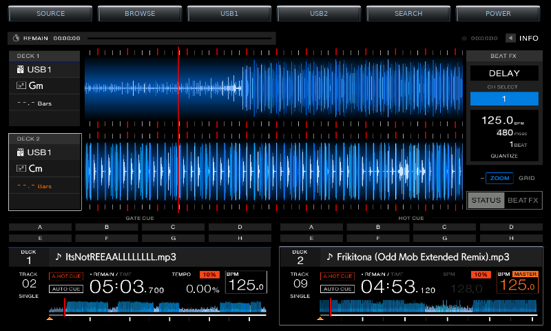
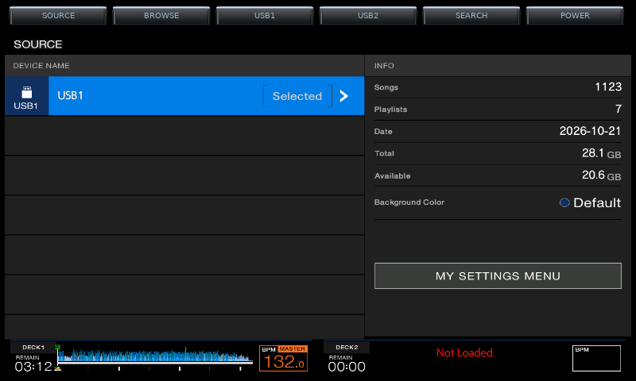
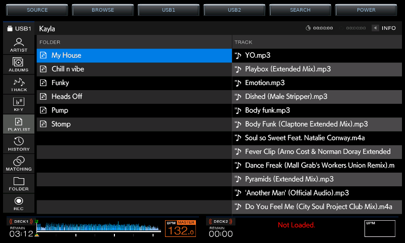
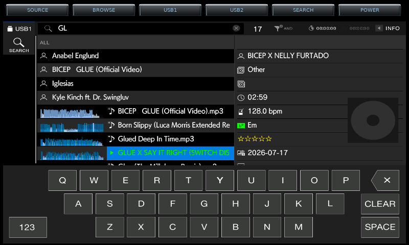

# RX3 on Raspberry Pi 4 + original 7-inch touchscreen

Pioneer XDJ-RX3 firmware research build for a **Raspberry Pi 4B (4 GB)**, the **original Raspberry Pi 7-inch 800×480 DSI touchscreen**, and a **Pioneer DDJ-FLX4**. Based on [mutlisensor/Rx3-flx4](https://github.com/mutlisensor/Rx3-flx4).

## Included controller mappings

| Controller | Mapping status |
|---|---|
| Pioneer DDJ-FLX4 | Included; tested on hardware during the Pi trials. |
| Pioneer DDJ-400 | Included with automatic detection; **untested on DDJ-400 hardware**. Compatibility and all controls still need verification. |

These are the only two controller profiles included in this build.

## Latest combined build — v9b + tested browse-knob fix, 5 November 2026

The previously separate host-side updates are now included in the source and installer:

- Six raised top buttons: **SOURCE · BROWSE · USB1 · USB2 · SEARCH · POWER**.
- Full-width firmware display below the button row, with matching touch coordinates.
- Silver bevels, charcoal button faces, softer blue lettering and left-to-right hold progress.
- Native SEARCH on finger release, with the working v9b navy recolour of the native letter keys. Auxiliary keyboard keys retain their native appearance.
- Continuous three-second POWER hold; releasing or leaving the button cancels.
- Startup repaint, AA display filtering and the Pi-tested DRM VBlank path with timer fallback.
- FLX4 4-beat loop/exit, Shift + Hot Cue Gate Cue toggle/indicator, and Beat FX CH1/CH2/both selection from the archived installer bridge.
- **Tested FLX4 BROWSE-knob fix:** pressing the knob on the main deck screen opens the library; turning it scrolls tracks, and pressing it in the library selects the highlighted track. Deck detection now uses the two measured stable firmware label regions (deck 75/75 versus library 204/0), avoiding the former four-region false negative.
- Pi 4 ARMv7 shim build, original DSI unblanking and BCM2711 USB-hub protection.

The v9b navy keyboard and the two-region FLX4 BROWSE-knob mapping were tested working on the user's Pi. **This consolidated fresh installation has not yet been tested on the Pi.** Keyboard styling can be refined later. Audio latency remains under investigation; this update does not claim a new audio fix. DDJ-400 compatibility is unverified for this combined build.

## Screenshots

Screenshots from the Pi trials on the original 800×480 display. The main, SOURCE and BROWSE views show v6 button styling. The SEARCH screenshot shows the native grey keyboard before the later v9b navy recolour.

### Main display



### SOURCE



### BROWSE



### SEARCH keyboard



## Install

Use Raspberry Pi OS/Debian 13 (trixie), 64-bit, and run as your normal user:

```bash
git clone https://github.com/mikayla-fox/Rx3-flx4-Pi4-7inch.git ~/Rx3-flx4
cd ~/Rx3-flx4
bash install-rx3.sh --fresh
```

The installer installs dependencies, recovers the firmware from its upstream sources, builds the runtime and host helpers, and enables RX3 at boot. When it finishes, activate it with `sudo reboot`. It does not reboot automatically.

### Existing installation

Keep your current checkout, and use a **separate new checkout** so local trial edits and old sources remain available:

```bash
git clone https://github.com/mikayla-fox/Rx3-flx4-Pi4-7inch.git ~/Rx3-flx4-v9b
cd ~/Rx3-flx4-v9b
bash install-rx3.sh --update
```

Update mode preserves the existing recovered firmware/runtime and settings, saves the old host binaries, shim and service/rule files, and configures RX3 to use the new checkout. It prints the backup location. Activate with a full reboot when ready; do not apply while performing a DJ set. Keep the previous checkout and backup until the combined install is verified.

See [the Pi 4 installation notes](docs/PI4-INSTALL.md), [controller key map](KEYMAP.md), and [upstream detailed installation reference](INSTALL.md).

## Firmware is not included

No Pioneer code, firmware image, decryption key, or patched player binary is in this repository, and
none should ever be committed to it — they are Pioneer/AlphaTheta property. `.gitignore` blocks them.

You supply them yourself, from the official sources:

- Firmware: the official XDJ-RX3 v1.19 update package from AlphaTheta support downloads.
- GPL source distribution: Pioneer DJ's open-source code distribution page, which is where the
  per-sector AES key comes from.

`rx3-handoff/ASTRA-PROMPT.md` lists the exact URLs and the recovery sequence, and
`rx3-handoff/recover-firmware.py` plus `firmware_image.py` perform the extraction. Place the results
in `rx3-handoff/extracted/` and `build-rootfs.sh` will assemble the chroot from them.

## Source layout

`rx3-handoff/` contains the presenter, touch bridge, controller bridge, firmware-recovery tools, runtime builder and service installer. `install-rx3.sh` is the combined Pi 4 entry point. Paths are resolved from the checkout owner rather than a fixed username.

## Credits and scope

Upstream emulation/interoperability work: [mutlisensor/Rx3-flx4](https://github.com/mutlisensor/Rx3-flx4). Pi 4/original 7-inch integration and host UI trials: this fork. Pioneer/AlphaTheta firmware remains separate and is not distributed in this repository.
